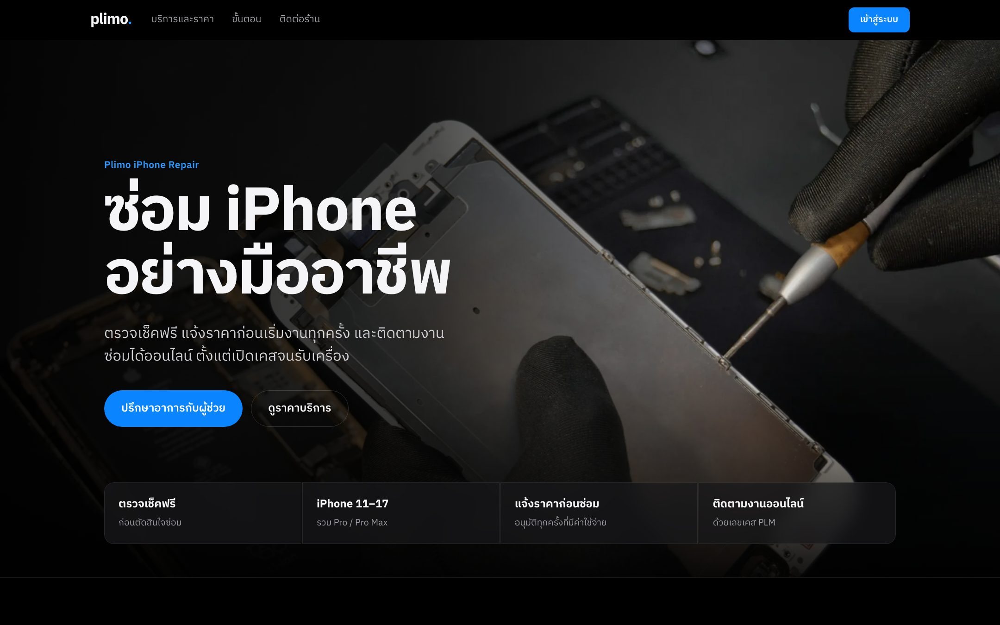
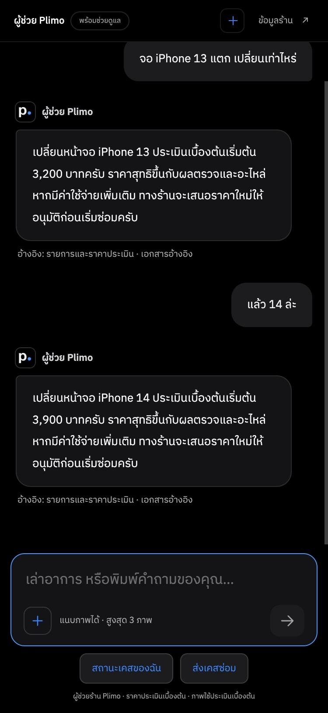
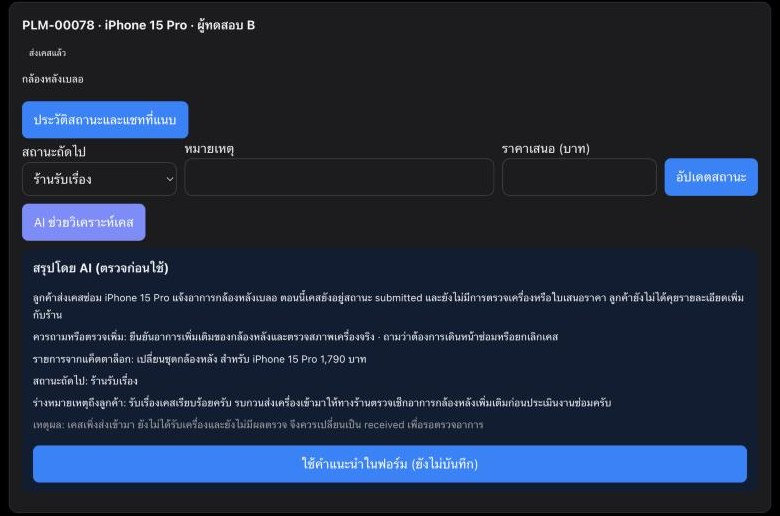
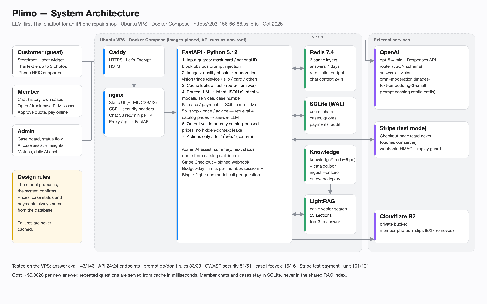

# Plimo — iPhone Repair Chatbot

An LLM-first customer assistant and admin copilot for a Thai iPhone repair shop. Customers ask in everyday Thai (text or photos), open and track repair cases, approve quotes and pay online; staff get AI case summaries, catalog-checked quote suggestions and daily insights.

**Live demo:** https://203-156-66-86.sslip.io · **ภาษาไทย:** [docs/README.th.md](docs/README.th.md)

| Storefront | Chat (multi-turn) | Admin AI assist |
|---|---|---|
|  |  |  |

## Highlights

- **Grounded answers, not guesses.** Prices come only from the shop catalog and every answer is checked: an amount the catalog does not back is replaced. Pro / Pro Max never inherit base-model prices. Unknown facts (warranty, address, repair time) are answered as "not confirmed" instead of invented.
- **The model proposes, the system confirms.** Opening a case or approving a quote from chat is a stored proposal that runs only after the customer types "ยืนยัน", with ownership and state re-checked. Case status and payments are read from the database, never generated.
- **Measured RAG.** Knowledge is split into 53 sections and retrieval is scored on its own (hit@1 / hit@3 / MRR). Tuning moved hit@1 from 31% to 88% on the same 26 questions; on today's larger knowledge base (40 questions) the right document is in the top 3 for 98%.
- **Cheap and fast.** Six cache layers with single-flight, OpenAI prompt caching and a daily USD budget: about **$0.0028 per new answer**, cached answers in milliseconds.
- **Defence in depth.** Input guards, an LLM router, output validators, rate limits, PII masking, image moderation and triage, signed payment webhooks. Mapped to OWASP Top 10 for LLM 2026 and OWASP Top 10:2025.
- **Tested end to end.** 143 graded answer cases, every API endpoint, randomized do/don't prompt rules, 51 security checks, the full case lifecycle and a real Stripe test payment, all on the public server.

## Features

**Customers (no account needed)**
- Thai Q&A about services, prices, opening hours and symptoms, with follow-ups ("แล้ว 14 ล่ะ" → iPhone 14 price)
- Up to 3 photos per message (iPhone HEIC supported): cracked screens, battery health, alerts, payment slips
- Vague questions get one clarifying question; several questions in one message are all answered

**Members**
- Open a repair case from chat; the assistant asks for a missing model or symptom, then waits for confirmation
- Track cases by number in any form (PLM-00012, plm12, เคส 12, Thai digits)
- Approve or reject quotes in chat or in the account page; pay with Stripe Checkout (test mode)
- Chat history, private photo storage and a case timeline
- Reply to the shop on the case itself (e.g. confirm the model); case answers in chat follow the conversation while the facts under them come from the database

**Admin**
- Case board with an enforced status flow (submitted → received → checking → awaiting approval → repairing → ready → closed); repair cannot start before the customer approves a quote
- Message the customer without changing the status; the latest customer reply shows on the case card
- AI case assist: summary, missing information, next status, quote from the catalog, draft note to the customer (all validated)
- Daily insights (top questions, questions the bot could not answer) and metrics (cache hit rate, tokens, AI cost)

## Architecture



Request path: **guards → cache → router → (SQLite for cases/payments) or (catalog + RAG + answer LLM + validator)**. Details, cache keys and flows: [qa/diagrams/architecture.md](qa/diagrams/architecture.md).

| Layer | Technology |
|---|---|
| Frontend | Plain HTML / CSS / JS (no framework), dark theme, WebP images |
| Edge | Caddy (automatic HTTPS) + nginx (static files, CSP, rate limits) |
| Backend | Python 3.12, FastAPI, Uvicorn |
| LLM | OpenAI `gpt-5.4-mini` via the Responses API with JSON schema; omni-moderation for images |
| RAG | LightRAG (naive vector mode) + `text-embedding-3-small` |
| Data | Redis 7.4 (cache, limits, sessions), SQLite (members, cases, quotes, payments) |
| Storage / payments | Cloudflare R2 (private images), Stripe Checkout + webhook (test mode) |
| Ops | Docker Compose, one-command VPS install, daily backups, pinned images and dependencies |

## Test results (public server)

| Suite | Result | Report |
|---|---|---|
| Answer quality eval (9 categories) | **143/143** | [eval-vps.md](qa/results/eval-vps.md) |
| Every API endpoint + access control | **24/24 endpoints**, 33/33 checks (before `POST /api/member/cases/{id}/reply`, which is unit-tested) | [api-check-vps.md](qa/results/api-check-vps.md) |
| Randomized do/don't prompt rules | **33/33** (17 rules) | [prompt-rules-vps.md](qa/results/prompt-rules-vps.md) |
| RAG retrieval (40 labelled questions) | hit@1 72%, **hit@3 98%**, MRR 0.85 | [retrieval-vps.md](qa/results/retrieval-vps.md) |
| Security, OWASP Top 10:2025 | **51/51** | [security-vps.md](qa/results/security-vps.md) |
| Case lifecycle with AI (open → close) | **16/16** steps | [lifecycle-vps.md](qa/results/lifecycle-vps.md) |
| Stripe test payment + webhook | paid, both events delivered | [stripe-payment-vps.md](qa/results/stripe-payment-vps.md) |
| Unit / contract (mocked providers) | **101/101** (17 Oct changes: 94/94 without the Redis suite) | [unit-latest.md](qa/results/unit-latest.md) |

**Test plan:** [qa/test-plan.md](qa/test-plan.md) (objectives, suites, pass criteria, bugs found) · **Test sets:** [qa/eval_suite.json](qa/eval_suite.json) (143 cases), [qa/prompt_rules.json](qa/prompt_rules.json) (17 rules / 33 questions), [qa/images/](qa/images/) (synthetic test images) · **How to run each suite:** [qa/README.md](qa/README.md) · **Guardrails and OWASP mapping:** [qa/guardrails.md](qa/guardrails.md)

**Course submission (Thai):** [development and test report (.docx)](docs/submission/Plimo-iPhone-Repair-Deliverable2.docx) · [test summary](qa/results/SUMMARY.md) · [presentation notes](qa/presentation.md)

## Run locally

Requirements: Docker Desktop, an OpenAI API key.

```bash
cp .env.example .env
```

Set `OPENAI_API_KEY`, a random `LIGHTRAG_API_KEY` and `ADMIN_PASSWORD` (10+ characters). Optional: `STRIPE_SECRET_KEY=sk_test_...` for payments, the `R2_*` values for cloud image storage.

```bash
docker compose --profile rag up -d --build
```

```bash
docker compose exec api python ingest.py --ensure
```

```bash
docker compose exec api python seed_demo.py
```

Open http://127.0.0.1:8081. Demo member: `demo_user`; demo admin: `demo_admin`. Passwords are in [qa/member-demo.md](qa/member-demo.md). Test card: `4242 4242 4242 4242`, any future date, any CVC.

Run the tests:

```bash
docker compose exec -T api python -m unittest discover -s . -p 'test_*.py'
```

```bash
python3 qa/run_eval.py
```

## Deploy to a VPS

Ubuntu 22.04 / 24.04, 2 vCPU / 4 GB RAM is enough (models run at OpenAI). From your machine, with SSH access to the server:

```bash
bash deploy/deploy.sh ubuntu@<server-ip>
```

`deploy.sh` uploads the project and your local `.env`, then runs [deploy/install.sh](deploy/install.sh), which:

- installs Docker and sets up a firewall and swap
- gets HTTPS automatically at `https://<ip>.sslip.io` (or pass a domain)
- builds the stack and waits for health checks
- indexes the knowledge base: unchanged sections are skipped at no cost and failed ones are retried
- seeds demo data and schedules a daily backup

Rerun the same command to deploy changes.

For payments, add a Stripe webhook endpoint `https://<your-host>/api/stripe/webhook` with events `checkout.session.completed`, `checkout.session.async_payment_succeeded` and `checkout.session.expired`, put its `whsec_...` into `STRIPE_WEBHOOK_SECRET`, and deploy again.

## Project layout

```
backend/     FastAPI app: router, RAG answer path, membership, payments, admin AI, tests
dist/        Static storefront, chat widget, member and admin pages
knowledge/   Shop knowledge base (Markdown, ~6 A4 pages)
deploy/      deploy.sh, install.sh, Caddyfile, backup.sh
qa/          Eval suites and runners, security checks, results, diagrams, docs
docs/        Thai README, screenshots
```

## Limitations

- Some shop facts are not confirmed yet (address, warranty, repair time), so the bot says so instead of answering.
- Payments run in Stripe test mode only; live keys are refused.
- No password reset, notifications or appointment booking yet.
- LLM output varies: the suites pass, but some multi-turn phrasings can still be misread.

## Credits and license

Code: [MIT](LICENSE). Photos: [Unsplash License](https://unsplash.com/license), photographers listed on the site's [credits page](dist/credits.html).
