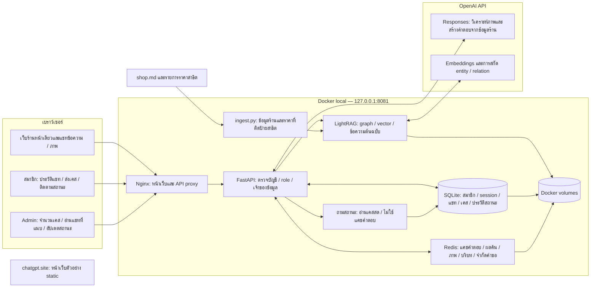

# Plimo — Architecture ปัจจุบัน (10 ตุลาคม 2026)

แผนภาพอ้างอิงระบบ Docker local ที่พอร์ต 8081 แยกข้อมูลสมาชิกออกจากคลังข้อมูลร้านที่ใช้ร่วมกันใน RAG

## เส้นทางใช้งาน

1. **แชท:** หน้าเว็บ → FastAPI → เช็กแคช Redis → วิเคราะห์ภาพเมื่อมีภาพ → ค้นข้อมูลร้านผ่าน LightRAG → OpenAI ตอบตามแหล่งข้อมูล → บันทึกข้อความของสมาชิกใน SQLite และบริบทล่าสุดใน Redis
2. **ดูประวัติ:** สมาชิก → FastAPI ตรวจเจ้าของ → SQLite → รายการบทสนทนา → เปิดข้อความเก่าในช่องแชทและคุยต่อได้
3. **ส่งเคสจากแชท:** สมาชิกเลือกบทสนทนา → FastAPI ตรวจสิทธิ์ → สร้างเลข PLM-xxxxx พร้อม conversation_id ใน SQLite
4. **อนุมัติราคา:** Admin ส่งใบเสนอ → สมาชิกยืนยันอนุมัติ/ปฏิเสธฉบับปัจจุบัน → เก็บผู้ตอบ เวลาและหมายเหตุ → Admin เริ่มซ่อมได้เมื่ออนุมัติราคาตรงกัน
5. **Admin:** ตรวจ role → ดูเคสและแชทที่แนบ → อัปเดตสถานะ / ราคาเสนอ / หมายเหตุ → บันทึกเหตุการณ์ → สมาชิกเปิด timeline ของตัวเอง

## Redis

| ข้อมูล | อายุแคช |
|---|---|
| คำตอบ | 30 นาที |
| ผลค้น RAG | 1 ชั่วโมง |
| ผลวิเคราะห์ภาพ | 24 ชั่วโมง |
| ข้อความล่าสุดในบทสนทนา | 24 ชั่วโมง |

คีย์แคชแบ่งตาม session / สมาชิกและบทสนทนา พร้อมเวอร์ชันคลังข้อมูลและ prompt ตามชนิดแคช Redis ยังใช้จำกัดคำขอและป้องกันคำขอใน session เดียวกันทำงานชนกัน

## ขอบเขตปัจจุบัน

- สมาชิกดูประวัติและเคสของตัวเอง ข้อมูลส่วนตัวไม่ถูก ingest ลง RAG ร่วมกัน
- Chatbot ตรวจคำถามสถานะเคสและอ่าน SQLite ตามเจ้าของบัญชีสดทุกครั้ง โดยไม่ใช้ GPT หรือ answer cache
- สมาชิกอนุมัติหรือปฏิเสธใบเสนอราคาที่มีเลข revision ผ่านพอร์ทัล ราคาใหม่ต้องอนุมัติใหม่ก่อนเริ่มซ่อม
- ประวัติแชทเก็บข้อความและจำนวนภาพ ไม่เก็บไฟล์ภาพถาวร
- แค็ตตาล็อก 16 รายการและราคาเป็นข้อมูลสาธิต ไม่ใช่ราคาที่ร้านยืนยัน
- ทดสอบ text RAG + OpenAI + answer cache จริงแล้ว ทดสอบคุณภาพภาพจริงครบชุดยังค้างอยู่
- เว็บ chatgpt.site เป็น static preview ระบบสมาชิก เคส Redis LightRAG และ OpenAI backend ทำงานผ่าน Docker local

ไฟล์ส่งออก: [PNG](stack-flow.png) · [SVG](stack-flow.svg) · [Flow เคส](member-case-flow.md) · [Flow RAG](rag-flow.md)

สร้างภาพใหม่ได้ด้วย `python qa/build_architecture.py` โดยไม่เรียก API
