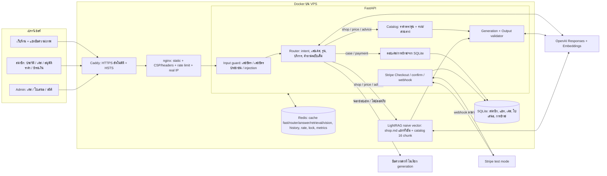

# Plimo — Architecture (15 ตุลาคม 2026)

แผนภาพนี้คือเวอร์ชันปัจจุบัน ภาพ `stack-flow.png` / `.svg` เป็นรุ่น 10 ตุลาคม 2026 ก่อนเพิ่ม router, การตรวจราคา, การชำระเงิน และ HTTPS

## เส้นทางของหนึ่งข้อความแชท

1. **Input guard** (โค้ดล้วน ไม่เสียค่า API): ซ่อนเลขบัตรและเลขบัตรประชาชน ถ้ามีเลขบัตรจะตอบเตือนทันทีโดยไม่ส่งต่อ, รูปแบบ injection ที่ชัดเจนตอบปฏิเสธทันที
2. **Fast cache**: คำถามแรกของบทสนทนาที่ไม่มีภาพ ค้นด้วยข้อความที่ normalize แล้ว (คำลงท้าย, ชื่อรุ่น, เลขไทย) ถ้า hit ตอบภายในไม่กี่มิลลิวินาที
3. **Router** (มี cache และ single-flight): ถ้าเป็นคำถามแรก LightRAG เริ่มค้นคู่ขนานไปเลย
4. **เคส / การชำระ**: อ่าน SQLite สดทุกครั้ง ไม่ cache จำ "เคสที่กำลังคุย" เพื่อให้ถามต่อได้ ถ้ามีคำถามร้านปนมาด้วยจะตอบต่อท้าย
5. **ร้าน / ราคา / คำแนะนำ**: แถวราคาจาก catalog + ข้อมูลจาก LightRAG + วันเวลา (ถ้าจำเป็น) → generation → validator ตรวจตัวเลขทุกตัวและเครื่องหมายข้อมูลภายใน → เก็บใน answer cache ร่วม
6. **Metering**: นับ token จริงทุก call, ตรวจเพดานรายวันก่อนเรียก OpenAI ทุกครั้ง

## Cache

| ชั้น | Key | ใช้ร่วมข้ามผู้ใช้ | อายุ |
|---|---|---|---|
| fast | ข้อความคำถามแรกที่ normalize แล้ว | ใช่ | 12 ชม. |
| router | ข้อความ + 2 เทิร์นล่าสุด + เคสที่คุยอยู่ | ใช่ (บริบทต้องเหมือนกัน) | 12 ชม. |
| answer | คำถามฉบับเต็ม + intent + รุ่น/บริการ + เวอร์ชัน KB/prompt/model/catalog | ใช่ | 12 ชม. (คำถามเรื่องวันเวลา 10 นาที) |
| retrieval | คำถามฉบับเต็ม + เวอร์ชัน KB | ใช่ | 12 ชม. |
| vision / คำตอบที่มีภาพ | hash ภาพ + บทสนทนา | ไม่ | 24 ชม. / 30 นาที |
| history, active case | บทสนทนา | ไม่ | 24 ชม. |

ไม่ cache คำตอบเคส การชำระเงิน และข้อความที่มีข้อมูลอ่อนไหว คำตอบที่ cache ร่วมสร้างจากคำถามฉบับเต็มที่ตัดข้อมูลส่วนตัวแล้ว ไม่ใช้ history ดิบ

## การชำระเงิน

สมาชิกอนุมัติใบเสนอ → `POST /api/member/cases/{id}/checkout` (จำนวนเงินจาก DB, idempotency key) → หน้า Stripe Checkout → กลับมาที่ `/?payment=success` → `GET /api/member/payments/confirm` ดึง session จาก Stripe แล้วตรวจจำนวนเงิน สกุลเงิน และ metadata → บันทึกการชำระ + เหตุการณ์ในเคส; webhook `checkout.session.completed` ทำงานเดียวกันแบบ idempotent
