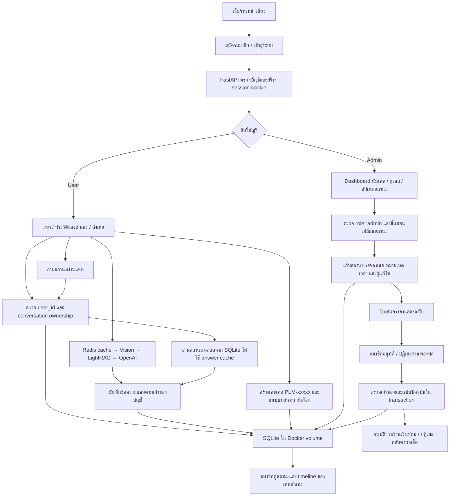

# Flow สมาชิกและเคสซ่อม (MVP local)

ลำดับสถานะ: ส่งเคส → ร้านรับเรื่อง → ตรวจเช็ค → รออนุมัติราคา → กำลังซ่อม → พร้อมรับเครื่อง → ปิดเคส (ยกเลิกได้ก่อนซ่อม)

สมาชิกกดยืนยันอนุมัติหรือปฏิเสธราคาในพอร์ทัลได้ ราคาใหม่ต้องอนุมัติใหม่ ระบบกันการข้ามอนุมัติก่อนเริ่มซ่อมงานที่มีราคาเสนอ ยังไม่มีระบบชำระเงินของลูกค้า ไฟล์ภาพใช้วิเคราะห์ครั้งนั้นและไม่เก็บเป็นประวัติภาพถาวร ข้อความแชทเก็บถาวรและเปิดย้อนหลังได้

RAG มีเฉพาะข้อมูลร้านและราคาสาธิต ไม่ ingest ประวัติส่วนตัวหรือเคสของสมาชิก

ระบบบน chatgpt.site เป็น static preview ส่วนสมาชิก SQLite เคส และ RAG ทำงานผ่าน Docker local
