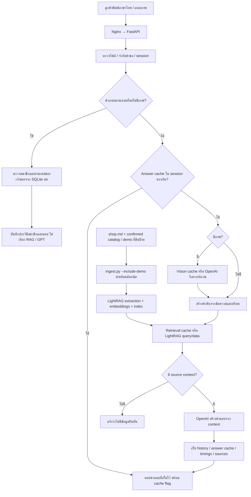

# ลำดับตอบคำถาม

ทดสอบ text RAG กับ OpenAI และ answer cache จริงแล้ว ดู qa/results/price-cache-model.json ส่วนการทดสอบคุณภาพภาพจริงครบชุดยังไม่ได้รัน สมาชิกมีประวัติข้อความถาวรใน SQLite โดยตรวจเจ้าของบทสนทนาก่อนอ่าน
